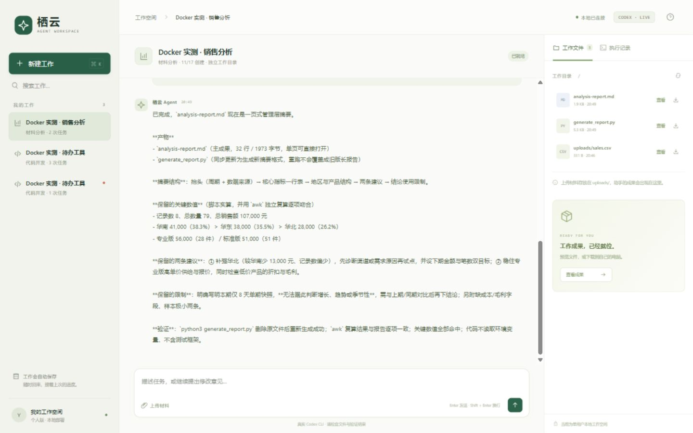

# 栖云 · Agent 工作台

一个单用户、可本地部署的浏览器 Agent 工作台。Node.js 24 原生 HTTP + SQLite，无前端构建依赖。支持多会话、任务进度、上传、成果预览/源码/下载、后续交流、取消、超时和重启恢复。

> 支持真实 **Codex CLI** 与明确标识的离线演示。Docker 已在本机完成构建和启动，当前使用服务端 API 配置运行真实 Codex；入口为 http://127.0.0.1:3101 。可复查的运行结果见 [验证记录](docs/VALIDATION.md) 和 `docs/delivery-evidence.json`。公开仓库：https://github.com/zihan12ai/qiyun-agent-workbench-20261117 。

## 立即运行

要求 Node.js **24+**（使用内置 node:sqlite）。

```sh
node server.mjs
```

打开 http://127.0.0.1:3100 。本项目无需 npm install。停止服务按 Ctrl+C。

环境变量可以通过当前 shell 或项目根目录 `.env` 配置：

```powershell
Copy-Item .env.example .env
node server.mjs
```

`.env`、`data/` 都已排除在 Git 之外。密钥只在服务端设置，切勿粘贴到聊天框或提交仓库。

## 两种运行模式

### 离线演示

默认 `AGENT_MODE=demo`。界面一直显示“离线演示”，由确定性程序执行：

- 代码开发：创建预置的待办网页，支持新增、完成、删除；再发“增加深色模式”修改原产物。
- 材料分析：上传 CSV 后实际计算数值字段统计和地区金额汇总；发送“整理成管理层摘要”调整报告。也支持 TXT/MD 的结构与原文摘录，不进行语义总结。
- 任意代码开发、自然语言推理、PDF/Word 解读需要真实模式。

首页两个示例按钮会创建会话并开始任务，销售 CSV 是虚构演示数据，与 `examples/sales.csv` 相同。

### 真实 Codex CLI

安装官方 CLI（Docker 镜像会安装）：

```sh
npm install -g @openai/codex@0.114.0
```

`.env` 设置：

```dotenv
AGENT_MODE=codex
CODEX_API_KEY=你有权使用的密钥
OPENAI_BASE_URL=https://你的API地址/v1
CODEX_MODEL=平台实际提供的模型名
CODEX_BIN=codex
```

重启后，**新建会话**采用真实模式；已有演示会话继续保持原模式，避免混淆成果来源。

适配器使用 `codex exec --json --ephemeral --sandbox workspace-write`，以 stdin 传入请求，解析 JSONL 的 agent_message、command_execution、file_change、turn.failed 事件。配置独立 provider，凭据通过 `env_key=CODEX_API_KEY` 读取，协议为 **Responses API**。禁用 CLI 的 web_search，以兼容仅允许客户端执行工具的平台。

**协议要求**：`OPENAI_BASE_URL` 必须提供 CLI 兼容的 `/responses`。只有 `/chat/completions` 的平台不能直接使用；本 Demo 没有实现协议转换，须更换兼容入口或添加适配层。不能只凭 HTTP 连通就认为联调成功。

每个会话有独立 CODEX_HOME、工作目录；每轮保留原文件，并将最近 20 条交流（每条最多 6000 字）传入 CLI。这里采用“历史重放 + 工作目录”的续接策略，没有使用 CLI 原生 resume，较长对话会截断。

API 未配置、CLI 不存在、模型不兼容都会明确失败，**不会回退演示模式**。不会自动读取当前桌面 Codex 的登录信息。

## Docker

```sh
docker compose up --build -d
```

打开 http://127.0.0.1:3100 。默认 demo，无需 API；真实模式先准备 `.env`。如端口占用，在 `.env` 设置 `WORKBENCH_PORT=3101` 后访问 http://127.0.0.1:3101 。本机此次验证使用 3101。Dockerfile 使用 Node 24 + Codex CLI，非 root 用户，Compose 只绑定本机地址，drop ALL capabilities、no-new-privileges，数据使用命名卷持久保存。

镜像默认固定 `CODEX_VERSION=0.114.0`，构建时从官方 npm 下载。此版本的 Landlock + seccomp 沙箱已在本机 Docker 默认权限下通过工作目录可写、应用目录不可写的检查。0.169.0 的 bubblewrap 在本机 Docker 中无法创建命名空间，因此没有选用，也没有自动关闭沙箱。需要更换版本时，先验证沙箱和真实任务：

```sh
docker compose build --build-arg CODEX_VERSION=你验证过的版本
```

容器中保留 CLI 的 workspace-write 沙箱，没有关闭 Agent 权限限制。Docker 默认权限、cap_drop ALL 和 no-new-privileges 保持启用；本项目没有加入绕过沙箱的自动降级。

```sh
docker compose logs -f
docker compose down
```

`down` 保留数据卷；不要加 `-v`，除非确实需要删除所有工作。

## 使用与验证

1. 首页点击“把想法做成小工具”，等待完成，右侧预览 index.html。
2. 真实模式发送“把网页标题改为我的行动清单”，再次预览确认修改；离线模式可发送“增加深色模式”体验预置修改。
3. 回首页，点击材料分析示例，自动上传 sales.csv 并生成报告。
4. CSV 样例共 8 行：数量 79，销售额 107000；华南 41000、华东 38000、华北 28000。
5. 发送“整理成管理层摘要”，查看并下载 analysis-report.md。
6. 左侧切换两个工作，刷新或重新打开网页，验证聊天/文件仍然存在。
7. 离线模式可发“演示失败”测试失败恢复；真实模式会显示实际 API/CLI 错误。执行过程中可停止任务。

HTML 预览使用 iframe 与响应 CSP 双重 sandbox，不允许同源访问或联网。隔离预览中 localStorage 不可用；待办仍可操作，关闭预览后不保留该预览状态。下载后在独立页面打开，才会持久保存待办和主题。真实 Agent 生成的复杂多文件站点可能需要另行构建与运行，当前预览仅针对单文件静态 HTML。

```sh
node --test tests/*.test.mjs
```

测试覆盖后续修改、CSV 计算、上传下载、会话隔离、SQLite 持久化、取消/并发/失败恢复、重启中断恢复、路径穿越、跨站请求、缺少真实凭据、预览隔离。

真实端到端验证（会发起四轮模型任务并消耗 API 额度）：

```powershell
$env:WORKBENCH_URL="http://127.0.0.1:3101"
node scripts/verify-runtime.mjs
docker compose restart workbench
node scripts/verify-runtime.mjs --check-persistence
```

脚本通过应用接口创建两个会话、上传 CSV、执行四轮任务，断言产物变更与统计数值，记录运行 ID、CLI 事件数和文件 SHA-256；第二步验证重启后的会话与文件一致。等待重启完成后再运行持久化检查。不会把 API 密钥写入记录。

更多说明见 [演示脚本](docs/DEMO.md) 和 [验证记录](docs/VALIDATION.md)。

## 运行关系

浏览器 → Node 服务 → 容器内 Codex CLI → 配置的模型 API。Codex 在容器内读写会话目录、执行命令，结果再由 Node 服务呈现。镜像构建会自动安装 Linux CLI，无需下载 CLI 源码，也不挂载或调用宿主机 Codex Desktop。Docker 数据卷保存会话数据库和工作文件。

## 设计取舍

- 原生 Node HTTP：减少两小时交付中的依赖安装与打包成本；前端是原生模块，后端可直接运行。
- SQLite WAL：保存会话、消息、运行状态和有限日志；文件存在独立目录。重启将运行中任务标为中断，保留产物供用户继续。
- SSE：前端断开不会停止后端，重连后重新获取完整状态；10 秒轮询作为补充。默认最多两个并发任务，同一会话只允许一个。
- 无排队：容量满时返回 429，用户稍后重试；避免实现不可靠的内存队列。
- 凭据在服务端，CLI 输入走 stdin，不经过 shell 拼接。日志会对已知密钥做脱敏。

## 已知限制

- Docker 与真实任务的已验证范围见 docs/VALIDATION.md，进行中的验证不会标为通过。
- 单用户、无登录，默认仅本机。不要直接暴露公网。不同工作目录用于避免混淆，**不是对抗恶意 Agent 的强多租户隔离**；同一 OS 用户可访问整个数据目录。
- 真实 CLI 子进程继承服务端环境变量（含 API key），无法阻止用户主动要求 Agent 读取自身环境；此应用假定可信单用户。
- 文件名与下载路径校验，拒绝符号链接和隐藏路径；没有病毒扫描，也不防工作目录被恶意进程同时替换的竞态。
- 上传单文件 5 MB，列出最多 250 个文件和 6 层目录；不支持目录上传、全工作区打包、富 Markdown 渲染。
- 任务超时默认 10 分钟；取消会终止进程树。没有持久任务队列与断点自动重跑。进程崩溃前的 Agent 子进程不保证在所有宿主环境自动回收，推荐 Docker init。
- CLI 事件类型可能随版本变化；实际模型支持、沙箱运行、取消行为应在目标环境再验证。
- API 地址、模型、费用和凭据由使用者自行配置；本机验证仅通过应用调用用户在服务端配置的 API。

## 目录

```
server.mjs          HTTP API、SSE、运行编排
lib/store.mjs       SQLite 与恢复
lib/files.mjs       文件边界与上传
lib/codex.mjs       真实 Codex CLI 适配
lib/demo.mjs        明示的离线预置流程
public/             网页
examples/sales.csv  虚构演示材料
tests/              自动化集成验证
docs/               演示与验证记录
```

## 发布仓库

公开仓库在正式考试期间于 2026-11-17 新建，默认分支 main。`.env` 与 `data/` 不进入仓库；公开运行证据只使用虚构销售材料。

CLI 参考：[官方非交互模式文档](https://developers.openai.com/codex/noninteractive)、[配置参考](https://developers.openai.com/codex/config-reference)。

## Windows 本次构建网络说明

新安装 Docker 后，旧终端可能没有 Docker 的 PATH，需重开终端。若使用 Windows 本地代理且 Docker Hub 认证超时，构建客户端可能没有读取系统代理；应在当前构建进程配置 HTTP_PROXY/HTTPS_PROXY，并通过 build-arg 将容器构建阶段代理设置为 host.docker.internal 对应端口。不要把宿主的 127.0.0.1 代理地址传给容器。代理地址依各自环境配置，本项目不修改系统代理。

## 本次交付证据入口

- [演示步骤与实测截图](docs/DEMO.md)
- [Docker 与验证说明](docs/VALIDATION.md)
- [四轮真实任务索引及重启校验](docs/runtime-evidence.json)
- [完整脱敏消息、执行日志和文件 SHA-256](docs/delivery-evidence.json)
- [真实生成的网页](docs/demo-output/code/index.html) 与 [管理摘要](docs/demo-output/analysis/analysis-report.md)

## 桌面截图



此宽屏截图于考试结束后补拍，未修改应用功能。考试截止前最后提交：`608e5c7`（2026-11-17 20:56:04 +08:00）。
