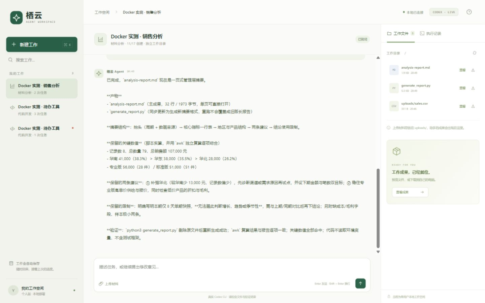
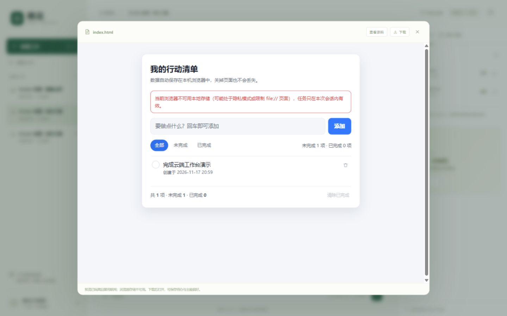
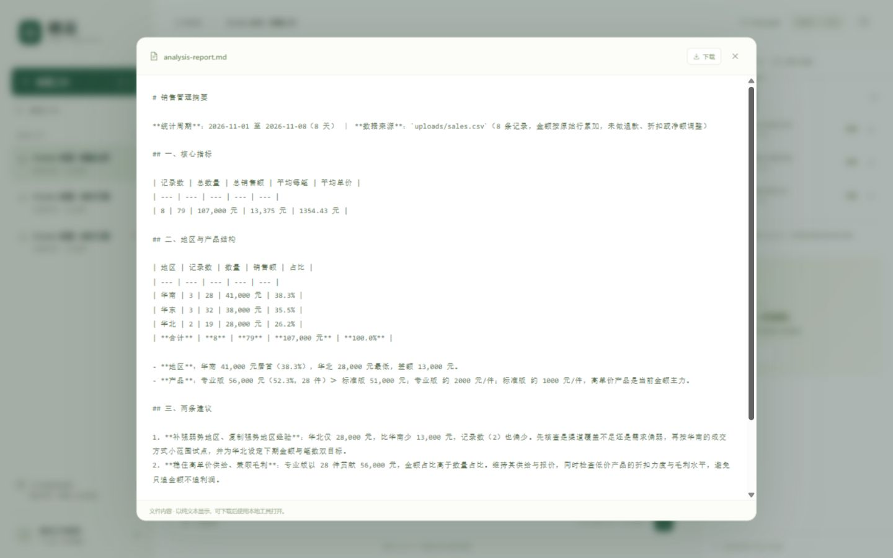

# 真实模式演示脚本（3–5 分钟）

服务入口：http://127.0.0.1:3101 。界面右上角应显示 **CODEX · LIVE**。本次真实任务与产物路径见 `delivery-evidence.json`，可直接打开现有两个“Docker 实测”会话展示。

1. 打开“Docker 实测 · 待办工具”，展示第一次请求、真实助手回复和 index.html / README.md。
2. 打开“执行记录”，展示 CLI 执行命令、文件变更与事件数；说明由容器内官方 Codex CLI 执行。
3. 预览 index.html，添加“准备演示”，完成并删除。确认界面标题“我的行动清单”。预览是隔离环境，localStorage 不可用；下载后打开可保存数据。
4. 展示成功的后续请求与回复：网页 title/h1 改为“我的行动清单”，README 增加快捷键说明，原网页文件已更新。主题修改遇到响应截断后已取消，记录保留，不算成功任务。
5. 切换“Docker 实测 · 销售分析”，展示 uploads/sales.csv、初次分析请求和报告。
6. 核对虚构数据：8 条记录、数量 79、金额 107000；华南 41000、华东 38000、华北 28000。执行记录可查看 Python 实际计算过程。
7. 展示后续交流：把报告改成管理摘要，保留统计、补充建议与数据局限；查看并下载 analysis-report.md。
8. 在两个会话间切换，刷新网页，证明记录和产物保留。重启容器后的 SHA-256 校验见运行证据。

## 从零复现

按 README 配置真实 API，然后执行：

```powershell
$env:WORKBENCH_URL="http://127.0.0.1:3101"
node scripts/verify-runtime.mjs
```

脚本会创建新的两个会话并执行四轮真实请求，消耗模型额度。执行耗时取决于模型和网络，录屏可在产物就绪后演示，真实过程通过运行日志和证据复查。

也可用首页两个示例按钮从界面创建任务，或新建工作手动上传 `examples/sales.csv`。

## 离线备选

没有 API 时，可将 AGENT_MODE 设为 demo 后重启并新建会话。页面明确显示“离线演示”，仅展示预置待办流程和确定性 CSV 统计。离线结果不能作为真实 Agent 联调证据。“演示失败”仅是离线模式故障测试指令。

公开仓库已创建；正式录屏尚未制作。演示脚本描述目标流程，实际已完成范围以 VALIDATION.md 与 delivery-evidence.json 为准。

## 本次浏览器实测截图

桌面工作台全貌：



真实 Codex 生成的待办网页，后续修改后仍可新增任务：



上传 CSV 后生成并继续修改的一页销售管理摘要：



截图在考试结束后重新拍摄为 1440 × 900 桌面宽屏，展示同一服务和已有产物；完整源码、报告和统计数据见 demo-output/ 与 delivery-evidence.json。考试截止前的最后提交为 608e5c7（2026-11-17 20:56:04 +08:00）。
